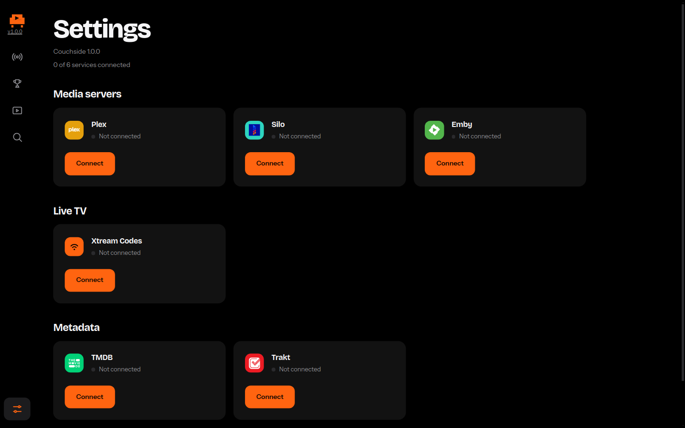

# Couchside


Couchside 1.0.0 is an all-in-one Windows player for Plex, Silo, MediaHub, and Xtream IPTV. It is an Electron app: a small local server and its own window, installed with an NSIS installer. You sign in with your own accounts. Nothing is shared between installs.



## Features

- Live TV from an Xtream Codes provider, played in the app
- Sports scoreboards, with matching live channels when the names line up
- On Demand movies and shows from Plex, Silo, and Emby (MediaHub)
- Search across those libraries
- Optional TMDB shelves for popular movies and shows
- Optional Trakt watchlist and recommendations
- One player, with theater mode and fullscreen, that keeps playing while you change pages
- Settings stored on this PC and encrypted when the operating system supports it

## Download and install

1. Open [Releases](https://github.com/kingdrowsy-exe/Couchside/releases).
2. Download `Couchside-Setup-1.0.0.exe` from the 1.0.0 release (or the latest `Couchside-Setup` exe).
3. Run the installer. It can create a desktop shortcut and a Start menu shortcut, both named Couchside.
4. You do not need Node.js to install or run that build.

The installer is not code-signed. Windows SmartScreen may warn. See Troubleshooting.

## First-run setup

With nothing connected, Couchside opens on Settings. Each service is optional except the one you want to watch.

- **Plex.** Choose "Link Plex account" and enter the code at [plex.tv/link](https://plex.tv/link). There is no token to copy. The link opens in your browser.
- **Silo.** Server URL, username, and password. Movies from Silo appear in On Demand. TV shows are not supported.
- **MediaHub.** The Settings page calls this Emby. Server URL, username, and password.
- **Xtream IPTV.** The server URL, username, and password from your provider. Live TV uses this.
- **TMDB** (optional). Paste the API Read Access Token from [themoviedb.org/settings/api](https://www.themoviedb.org/settings/api). This fills the Popular Movies and Popular Shows shelves.
- **Trakt** (optional). Register an app at [trakt.tv/oauth/applications](https://trakt.tv/oauth/applications) with redirect URI `urn:ietf:wg:oauth:2.0:oob`, paste its Client ID and Secret, then link the account with the device code Couchside shows.

## Where settings live

On Windows the file is:

`%APPDATA%\Couchside\data\settings.json`

Electron's safeStorage encrypts it when encryption is available. On Windows that uses DPAPI. An encrypted file starts with the bytes `CSDH1`. If encryption is not available, the file stays plaintext JSON and is still only on this PC.

The first launch looks for an older Unified Media Hub profile. If Couchside does not already have `settings.json`, it copies that profile's `data` folder into the Couchside folder. It does not delete or overwrite the old folder.

## Building from source

Prerequisites: Node.js 22 and npm. The Windows installer is built on Windows, or by the Release workflow.

```bash
npm install
npm run install:all
npm test
npm start
npm run dist
```

- `npm install` installs the Electron app.
- `npm run install:all` installs the server and the web UI.
- `npm test` compiles the server and runs the tests.
- `npm start` builds the server and the UI, then opens the Couchside window.
- `npm run dist` builds and packages an installer for the OS you are on. On Windows that file is `release/Couchside-Setup-1.0.0.exe`.

`npm start` serves the window from `http://127.0.0.1:4173`. That port is only for the app on this computer.

## Releasing

Push a tag that starts with `v`, for example `v1.0.0`. The Release workflow builds the Windows installer on `windows-latest`, runs the tests, and attaches `Couchside-Setup-1.0.0.exe` to that GitHub release. You can also run the workflow by hand. It uploads the installer only when the run is a `v*` tag, or when you type one into the workflow input.

The workflow does not sign the installer.

## Code signing

`signAndEditExecutable` is false. Couchside does not sign the exe. Until you sign it yourself, SmartScreen will warn people who download it.

## Troubleshooting

**SmartScreen says the installer is unrecognized.** Choose More info, then Run anyway. The file is unsigned. Confirm you downloaded `Couchside-Setup-1.0.0.exe` from this repository's Releases page.

**Settings stays on "Loading settings…".** That happened when `settings.json` was empty or cut off, and the page never handled the failed request. 1.0.0 shows an error and a Try again button, and it leaves the damaged file in place. Connecting a service writes a new file. The file is `%APPDATA%\Couchside\data\settings.json`.

**Live TV sits a few seconds behind, or buffers.** Playback stays about eight seconds behind the live edge on purpose, so the picture does not jump back and forth. A short buffer on sports is expected. Catch-up does not speed the video up.

## Privacy

Usernames, passwords, and service tokens stay in the local settings file. Couchside has no account of its own and does not upload your library. The app talks only to the Plex, Silo, Emby, Xtream, TMDB, and Trakt servers you configure, and to the stream addresses those servers return.

## Third-party software

The installer bundles an [FFmpeg](https://ffmpeg.org) binary through [`ffmpeg-static`](https://github.com/eugeneware/ffmpeg-static) (GPL-3.0-or-later). Couchside runs it as a separate process, and only to convert audio the player cannot decode (AC-3 / E-AC-3 on some live feeds) to AAC. Video is copied through and is not re-encoded.
